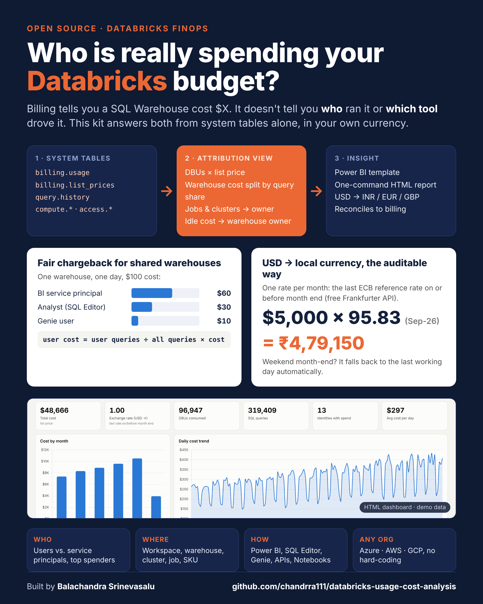
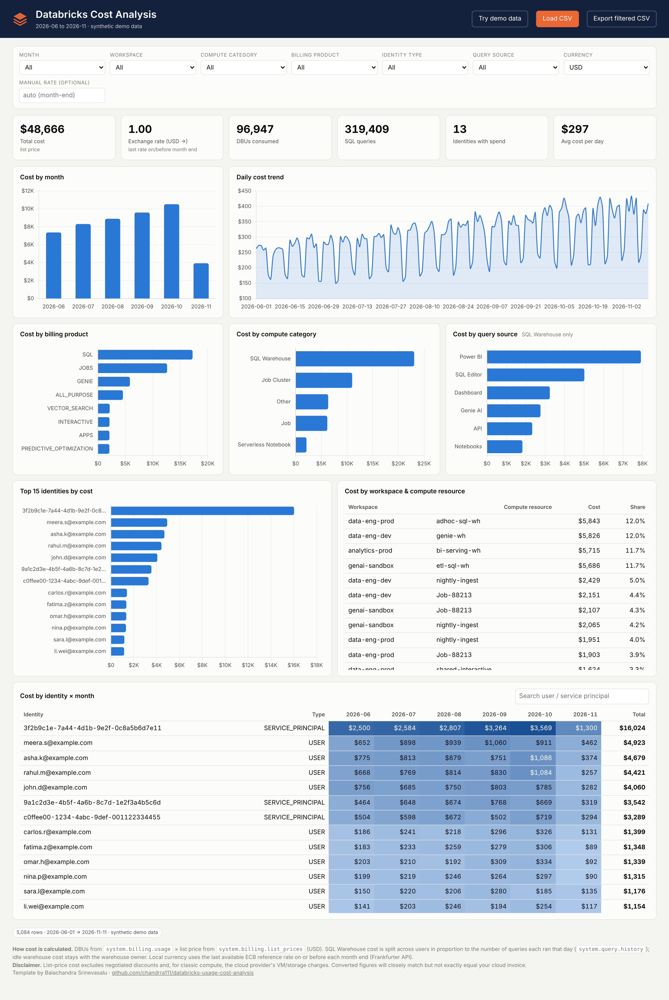

# Databricks Usage & Cost Analysis

**Know who spends what on Databricks, where, and through which tool, in your own currency.**

A ready-to-use kit built only on Databricks **system tables**. It works for any organisation on Unity Catalog (Azure, AWS or GCP), with no hard-coded values.



## What you get

| Folder | What's inside |
|---|---|
| [`sql/`](sql) | `01` the attribution view (fully commented) · `02` FX rate table + month-end rate view · `03` cost in local currency · `04` reconciliation checks |
| [`notebooks/`](notebooks) | `load_fx_rates.py`: daily USD→INR/EUR/GBP… rates from the free Frankfurter (ECB) API |
| [`python/`](python) | `run_cost_report.py`: give it a workspace URL + token, get a CSV and an HTML dashboard |
| [`html/`](html) | `databricks-cost-dashboard.html`: self-contained dashboard (drop in a CSV or embed data) with currency switcher and demo data |
| [`powerbi/`](powerbi) | **Ready-made Power BI project** (`pbip/DatabricksCostAnalysis.pbip`, 6 pages of visuals, Demo/Databricks switch) plus Power Query, DAX and a guide to export a `.pbit` |
| [`sample_data/`](sample_data) | Synthetic demo dataset (fictional names) used by the Power BI Demo mode |
| [`docs/`](docs) | [How the attribution works](docs/HOW_IT_WORKS.md) · [How USD is converted to INR](docs/CURRENCY_CONVERSION.md) |

## Key ideas

- **Fair SQL Warehouse chargeback.** Each warehouse's daily cost is split across users in proportion to the queries they ran (`system.query.history`), by query count or, with one setting, by query duration. Idle cost stays with the warehouse owner, so totals reconcile to billing.
- **Direct attribution for everything else.** Jobs, clusters, serverless notebooks, apps and vector search use `run_as` → `owned_by` → `created_by`.
- **"Which tool drove the cost?"** Power BI, SQL Editor, Genie, Dashboards, APIs, Tableau, Notebooks.
- **Users vs. service principals**, with an attribution-confidence flag on every row.
- **Local currency** at the last ECB reference rate on or before each month end.

## Quick start

### Option A: HTML dashboard in 3 commands

```bash
pip install databricks-sql-connector
export DATABRICKS_TOKEN=dapi...            # PAT or OAuth token of a user/SP that can read system tables
python python/run_cost_report.py \
  --host adb-1234567890123456.7.azuredatabricks.net \
  --http-path /sql/1.0/warehouses/abcdef1234567890 \
  --inline --currency INR                  # or --view main.finops.vw_billing_usage_with_attribution
```

Open `databricks_cost_report.html`.


 To try it without a workspace, open `html/databricks-cost-dashboard.html` and click **Try demo data**.

> A browser cannot call the Databricks API directly (CORS), and a token should never sit in a web page. That is why the small Python step pulls the data and the HTML only renders it.

### Option B: create the views (recommended for Power BI / shared use)

1. Replace `<catalog>.<schema>` and run `sql/01_vw_billing_usage_with_attribution.sql`.
2. Optional, to convert in Databricks: run `sql/02`, schedule `notebooks/load_fx_rates.py` daily, then run `sql/03`.
3. Run `sql/04_reconciliation_checks.sql`. `diff_usd` should be ≈ 0.
4. Build the report with [`powerbi/SETUP.md`](powerbi/SETUP.md), or query the view from any BI tool.

## Prerequisites

- Unity Catalog enabled, plus these system schemas enabled by an account admin: `system.billing`, `system.compute`, `system.query` and `system.access`.
- `SELECT` on those schemas for whoever creates the view. Readers only need `SELECT` on the view.
- A SQL Warehouse (serverless is cheapest for this workload).

## Important caveats

Cost = DBUs × **list price** (USD). It excludes negotiated discounts and, for classic compute, the cloud provider's VM/storage bill. Converted figures will closely match, but not exactly equal, your invoice. Details are in [CURRENCY_CONVERSION.md](docs/CURRENCY_CONVERSION.md#why-your-number-will-not-exactly-match-the-cloud-invoice).

## Author

Created by **Balachandra Srinevasalu** · Data & Analytics leader · [GitHub @chandrra111](https://github.com/chandrra111)

Issues and pull requests are welcome. If this helped you, a ⭐ helps others find it.

## License

[MIT](LICENSE)
